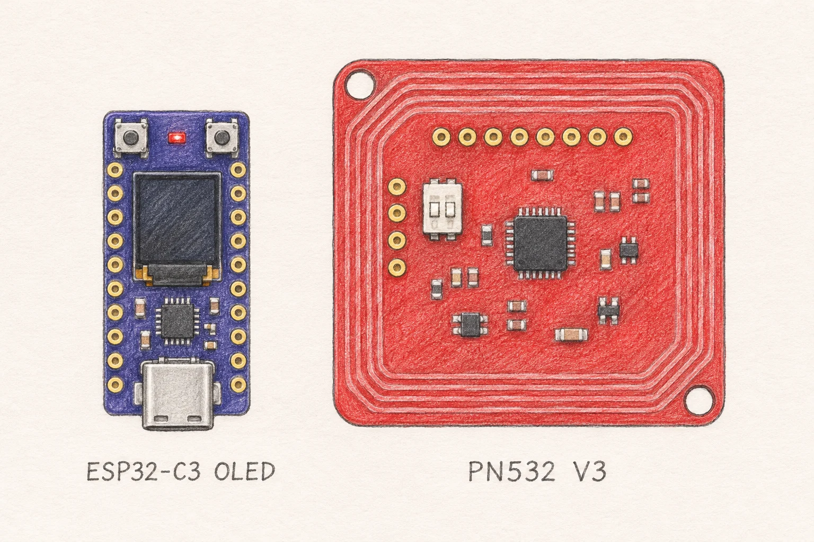
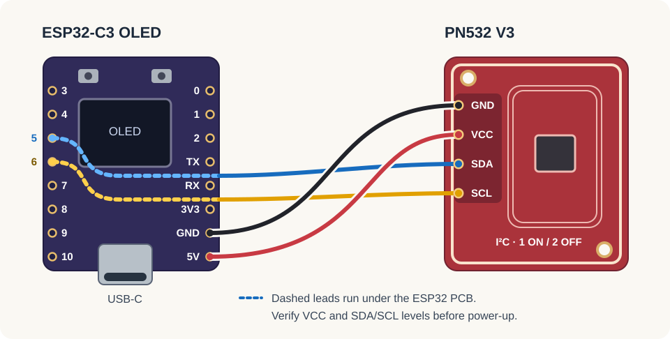

# NFC Reader

This project pairs an ESP32-C3 board with a PN532 breakout. The first milestone is to read a tag UID with the OLED and the reader on the same I²C bus. The [device specification](spec.md) tracks the design decisions and bench checks.

## Board top views

| ESP32-C3 with 0.42-inch OLED | PN532 NFC Module V3 |
| :---: | :---: |
|  |  |

Reference photos from [Home Smart Mesh](https://homesmartmesh.github.io/microcontrollers/esp32/c3-oled42/) and [Cirkit Designer](https://docs.cirkitdesigner.com/component/64b18bca-1932-4bf5-854c-8dd0124534f1/nfcrfid-reader). Match both boards to the photos before wiring.

## Side-by-side sketch

Illustrative board layout. Use the board markings and schematics for pin locations.

## Hardware

- [diymore ESP32-C3 with 0.42-inch OLED](https://www.amazon.de/-/en/dp/B0GQL8YVPF). The board reference uses an SSD1306-compatible I²C OLED. Confirm the board revision before wiring.
- [Binghe PN532 NFC Module V3](https://www.amazon.de/-/en/dp/B0D86CPN5J). The listing shows a red breakout with a PCB antenna and a mode switch. Check the markings against the Elechouse reference before wiring.
- The kit includes an S50 card for the first UID read test.

## As-built wiring

The onboard OLED and the PN532 share the ESP32-C3's hardware I²C bus on **GPIO5 (SDA)** and **GPIO6 (SCL)**. Those are the pins printed **5** and **6** on the left edge with the OLED face up and USB-C toward you. The blue and yellow leads run under the ESP32. The black and red leads come from the opposite edge.

| Wire | ESP32-C3 marking | PN532 front marking |
| --- | --- | --- |
| Black | GND | GND |
| Red | 5V | VCC |
| Blue | 5 (GPIO5) | SDA |
| Yellow | 6 (GPIO6) | SCL |

The PN532 uses the four-pad header, ordered **GND, VCC, SDA, SCL** as shown face up in the sketch. The reverse side labels the signal pads **TXD** and **RXD** for UART mode. The module's own legend shows **I²C = 1, 0**, and the switches are now set to **1 ON, 2 OFF**. The soldered harness has four wires. The firmware still needs a PN532 driver that supports I²C polling without IRQ or reset wires.

## Bench checks

The wiring was checked against the front and rear photos. Electrical checks and communication results are pending.

1. With USB disconnected, check end-to-end continuity and look for solder bridges between GPIO5 and GPIO6 and between 5V and GND.
2. Verify that the actual breakout accepts 5 V at VCC and check its header-side SDA/SCL pull-ups with the ESP32 signal leads electrically isolated. The ESP32 side needs 3.3 V I²C levels.
3. Initialize the shared bus once with `Wire.begin(5, 6, 100000)`. Scan for the OLED at `0x3C` and the PN532 at `0x24` (7-bit addresses). NXP also lists the PN532's shifted write address byte, `0x48`.
4. Query the PN532 firmware version and check that the OLED still responds. Read the supplied S50 card, then remove and present it again. Record the UID read result before testing the lid or measuring read range.

## Datasheets and schematics

- [Espressif ESP32-C3 datasheet](https://documentation.espressif.com/esp32-c3_datasheet_en.html)
- [ESP32-C3 OLED board photo and schematic](https://homesmartmesh.github.io/microcontrollers/esp32/c3-oled42/)
- [OLED example firmware](https://github.com/ESP32Home/oled_042)
- [NXP PN532/C1 datasheet](https://www.nxp.com/docs/en/nxp/data-sheets/PN532_C1.pdf)
- [NXP PN532 user manual](https://www.nxp.com/docs/en/user-guide/141520.pdf)
- [Elechouse V3 module guide](https://www.elechouse.com/elechouse/images/product/PN532_module_V3/PN532_%20Manual_V3.pdf)
- [Elechouse V3 reference schematic](https://www.elechouse.com/elechouse/images/product/PN532_module_V3/PN532_shematic_drowing.pdf)

## PCB

The bench setup uses the two development boards. The [enclosure and harness concept](spec.md#enclosure-and-harness-concept) covers the board gap, the USB and display openings, and the coil-to-lid spacing for a first mockup.
