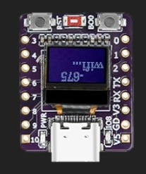

# NFC Reader

This project pairs an ESP32-C3 board with a PN532 breakout. The first milestone is to read a tag UID with the OLED and the reader on the same I²C bus. The [device specification](spec.md) tracks the design decisions and bench checks.

## Board top views

| ESP32-C3 with 0.42-inch OLED | PN532 NFC Module V3 |
| :---: | :---: |
|  |  |

Reference photos from [Home Smart Mesh](https://homesmartmesh.github.io/microcontrollers/esp32/c3-oled42/) and [Cirkit Designer](https://docs.cirkitdesigner.com/component/64b18bca-1932-4bf5-854c-8dd0124534f1/nfcrfid-reader). Match both boards to the photos before wiring.

## Side-by-side sketch

Illustrative board layout. Use the board markings and schematics for pin locations.

## Hardware

- [diymore ESP32-C3 with 0.42-inch OLED](https://www.amazon.de/-/en/dp/B0GQL8YVPF). The board reference uses an SSD1306-compatible I²C OLED. Confirm the board revision before wiring.
- [Binghe PN532 NFC Module V3](https://www.amazon.de/-/en/dp/B0D86CPN5J). The listing shows a red breakout with a PCB antenna and a mode switch. Check the markings against the Elechouse reference before wiring.
- The kit includes an S50 card for the first UID read test.

## Pinout for the first bench test

Use the PN532's four-pin I²C header. The `nfc_audio` prototype used GPIO5 for SDA and GPIO6 for SCL, and the OLED reference schematic puts those pins on the edge opposite 5V and GND. Run the signal pair under the ESP32 board if the modules are placed side by side.

- **SDA** connects ESP32-C3 GPIO5 to PN532 SDA.
- **SCL** connects ESP32-C3 GPIO6 to PN532 SCL.
- **Ground** is common to both boards.
- **VCC** depends on the breakout. Verify the supply requirements, the I²C pull-up voltage and the available current before connecting it. The ESP32-C3 bus uses 3.3 V logic.

The expected 7-bit addresses are `0x3C` for the OLED and `0x24` for the PN532. NXP gives the PN532 write address byte as `0x48`. The Elechouse V3 guide shows switch 1 **ON** and switch 2 **OFF** for I²C. Check the silkscreen on the Binghe board before applying power. Check whether the chosen driver needs separate IRQ or reset wires.

## Bench checks

1. Identify the OLED on the I²C bus with the PN532 disconnected.
2. With the module supply and bus levels verified, add the PN532 and read its firmware version. Check that the OLED still responds.
3. Read the supplied S50 card, remove it and present it again. Record the UID read result before testing enclosure materials or measuring working distance.

## Datasheets and schematics

- [Espressif ESP32-C3 datasheet](https://documentation.espressif.com/esp32-c3_datasheet_en.html)
- [ESP32-C3 OLED board photo and schematic](https://homesmartmesh.github.io/microcontrollers/esp32/c3-oled42/)
- [OLED example firmware](https://github.com/ESP32Home/oled_042)
- [NXP PN532/C1 datasheet](https://www.nxp.com/docs/en/nxp/data-sheets/PN532_C1.pdf)
- [NXP PN532 user manual](https://www.nxp.com/docs/en/user-guide/141520.pdf)
- [Elechouse V3 module guide](https://www.elechouse.com/elechouse/images/product/PN532_module_V3/PN532_%20Manual_V3.pdf)
- [Elechouse V3 reference schematic](https://www.elechouse.com/elechouse/images/product/PN532_module_V3/PN532_shematic_drowing.pdf)

## PCB

The bench setup uses the two development boards. The [enclosure and harness concept](spec.md#enclosure-and-harness-concept) covers the board gap, the USB and display openings, and the coil-to-lid spacing for a first mockup.
