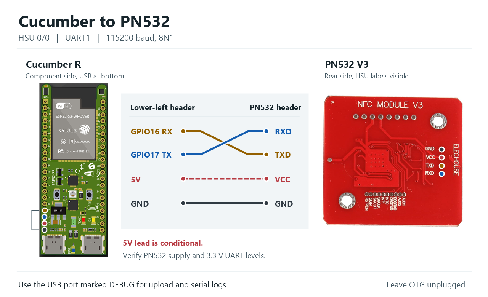

# NFC Reader

The primary build pairs an **ESP32-C3** with a **PN532 V3** on a dedicated I²C bus and defaults to **Jewel/Topaz tags**. The onboard 0.42-inch OLED uses a separate bus for the scan prompt and UID. The owner confirmed Topaz detection using a WhizTags Topaz 512. The [device specification](spec.md) records the current interface and remaining bench checks.

## Board top views

| ESP32-C3 with 0.42-inch OLED | PN532 NFC Module V3 |
| :---: | :---: |
|  |  |

Reference photos from [Home Smart Mesh](https://homesmartmesh.github.io/microcontrollers/esp32/c3-oled42/) and [Cirkit Designer](https://docs.cirkitdesigner.com/component/64b18bca-1932-4bf5-854c-8dd0124534f1/nfcrfid-reader). Match both boards to the photos before wiring.

## Hardware

- [diymore ESP32-C3 with 0.42-inch OLED](https://www.amazon.de/-/en/dp/B0GQL8YVPF). Verify the board revision against the photo and schematic.
- [Binghe PN532 NFC Module V3](https://www.amazon.de/-/en/dp/B0D86CPN5J). Match its markings and switch legend against the Elechouse reference.
- **WhizTags Topaz 512** is the Jewel reference tag for the current build. Use it for the default scan mode.

## C3 wiring

With the USB-C port facing down, GPIO0 and GPIO1 are the top two pads on the right edge. Connect the reader's four-pin header as shown.

| ESP32-C3 | PN532 front marking |
| --- | --- |
| GPIO0 | SDA |
| GPIO1 | SCL |
| GND | GND |
| Verified reader supply | VCC |

The PN532 uses hardware I²C at **100 kHz**, 7-bit address **0x24**. The OLED stays on its board wiring, **GPIO5 SDA / GPIO6 SCL**, using software I²C at address **0x3C**. The two buses have separate pull-ups. With power removed, set PN532 **switch 1 ON and switch 2 OFF (1/0)** and power-cycle the breakout. [Board schematic](https://homesmartmesh.github.io/microcontrollers/esp32/c3-oled42/) · [Elechouse V3 guide](https://www.elechouse.com/elechouse/images/product/PN532_module_V3/PN532_%20Manual_V3.pdf)

## Bench checks

1. With both boards off, check continuity and verify the PN532 supply against the actual breakout. With the C3 signal leads isolated, power the reader and confirm that the bus has adequate pull-ups and the ESP32-side SDA and SCL idle at 3.3 V. Use a bidirectional level shifter if the reader side is pulled to 5 V. Power down before reconnecting.
2. Use the firmware repo's default `esp32c3` target and open the C3 native USB serial monitor at **115200 baud**. Check for an address ACK, a valid PN532 firmware version, `polling Jewel/Topaz only back-to-back`, and `removal debounce 250 ms`.
3. With the OLED showing `SCAN` / `TAG`, present the Topaz 512. Expect one `Jewel tag UID:` line and the same four ID bytes on the OLED in two rows. Keep the tag in place to check duplicate suppression. Remove it until the console reports `Jewel tag removed` and the prompt returns, then present it again and compare the two UID reports.
4. Record the C3 display result, removal and re-presentation, and any electrical measurements. The owner reports working Jewel detection. The latest firmware record confirms both builds and still lists C3 OLED visual checking and measured scan timing as pending.

## Datasheets and schematics

- [Espressif ESP32-C3 datasheet](https://documentation.espressif.com/esp32-c3_datasheet_en.html)
- [ESP32-C3 OLED board photo and schematic](https://homesmartmesh.github.io/microcontrollers/esp32/c3-oled42/)
- [OLED example firmware](https://github.com/ESP32Home/oled_042)
- [NXP PN532/C1 datasheet](https://www.nxp.com/docs/en/nxp/data-sheets/PN532_C1.pdf)
- [NXP PN532 user manual](https://www.nxp.com/docs/en/user-guide/141520.pdf)
- [Elechouse V3 module guide](https://www.elechouse.com/elechouse/images/product/PN532_module_V3/PN532_%20Manual_V3.pdf)
- [Elechouse V3 reference schematic](https://www.elechouse.com/elechouse/images/product/PN532_module_V3/PN532_shematic_drowing.pdf)

## PCB

The bench setup uses the two development boards. The [enclosure and harness concept](spec.md#enclosure-and-harness-concept) covers the board gap, the USB and display openings, and the coil-to-lid spacing for a first mockup.

## ESP32-S2 Cucumber v1.1 reference

### I²C comparison on the Cucumber

The shared firmware can also build as `cucumber_s2_i2c` for the Gravitech Cucumber ESP32-S2-WROVER. Use **GPIO16 SDA / GPIO17 SCL**, common GND, and a verified VCC. The reader's front **SDA** and **SCL** positions are marked **TXD** and **RXD** on the back. The same 1/0 switch setting, 3.3 V pull-up checks, 100 kHz bus and `0x24` address apply. Use **DEBUG USB-C** for the FTDI UART0 monitor at **115200 baud, 8N1**, with OTG left unplugged. The Cucumber reports the tag over serial. [Gravitech Cucumber R](https://store.gravitechthai.com/product/cucumber-r-gravitech-esp32-s2-wifi-dev-board/11001005073001436) · [Elechouse V3 schematic](https://www.elechouse.com/elechouse/images/product/PN532_module_V3/PN532_shematic_drowing.pdf)

### ESP32-S2 Cucumber v1.1 serial bench test

The earlier HSU diagnostic used **GPIO17 TX → PN532 RXD** and **GPIO16 RX ← PN532 TXD** at 115200 baud, 8N1, with both switches OFF after a power cycle. The bench capture showed a valid outbound query and no full-swing reader ACK. This sketch records that comparison. The active firmware targets use I²C.

The Cucumber's DEBUG connector exposes UART0. OTG uses the ESP32-S2's native USB. If automatic entry to the bootloader fails, hold BOOT, tap RESET/EN and release BOOT. [ESP32-S2 boot mode guide](https://docs.espressif.com/projects/esptool/en/latest/esp32s2/advanced-topics/boot-mode-selection.html) · [Cucumber pinout](https://obrazki.elektroda.pl/6533666800_1590994173.png) · [PN532 rear photo](https://www.haljia.com/products/haljia-pn532-nfc-near-field-communication-rfid-v3-reader-writer-module-support-communication-with-mobile-compatible-with-arduino-raspberry-pi-diy-etc)
