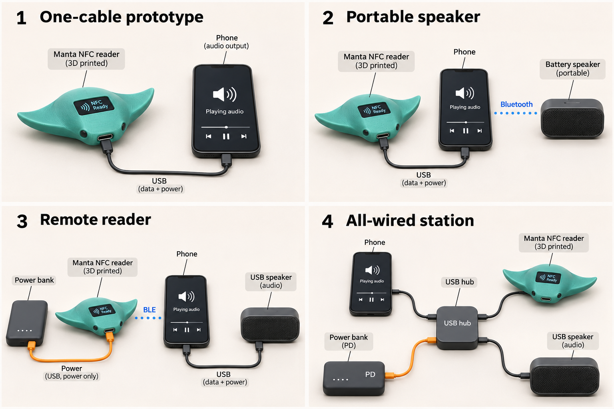

# Manta tag-to-sound concepts

The Manta detects a tag and sends its ID to a phone. In these four proposed setups, the phone selects and plays the sound. The wired options assume a USB-C Android phone with USB host support.

| Setup | Tag connection | Audio output | Power |
| --- | --- | --- | --- |
| 1. One-cable prototype | USB serial to phone | Phone speaker | Phone powers Manta over the data cable. |
| 2. Portable speaker | USB serial to phone | Bluetooth speaker | Phone powers Manta. Speaker uses its own battery. |
| 3. Remote reader | BLE to phone, or Wi-Fi over a shared network | USB audio speaker | A power bank travels with Manta. The speaker draws power from the phone or its own supply. |
| 4. All-wired station | USB serial through a hub | USB audio speaker on the same hub | A USB-C PD bank or charger feeds the hub. Charging the phone while it hosts both devices depends on the phone and hub. |

Start with setup 1 to check phone compatibility with the reader’s [existing USB serial output](README.md#bench-checks). Connect a USB data cable and confirm that the phone receives a fresh UID after tag removal and re-presentation. For a tabletop installation, try setup 4 and verify that scanning, USB audio playback and phone charging work together. Setup 3 suits a reader that needs to move independently and requires wireless event handling on the reader and phone.
