# NFC reader enclosure

[Concept sketches](#concept-sketches) · [Measurement drawings and readings](#measurements-for-the-first-cad-fit) · [CAD iterations](#cad-iterations)

## Concept sketches

### Overall layout

The base holds the wired ESP32-C3 and PN532 side by side. Short ledges support the ESP32 around the populated underside. Perimeter stops locate the PN532, with two plastic posts proposed at its diagonal mounting holes. The lid has a low OLED bezel, a higher roof over the wire bends, and a solid plastic tap face over the PN532. BOOT and RESET stay covered.

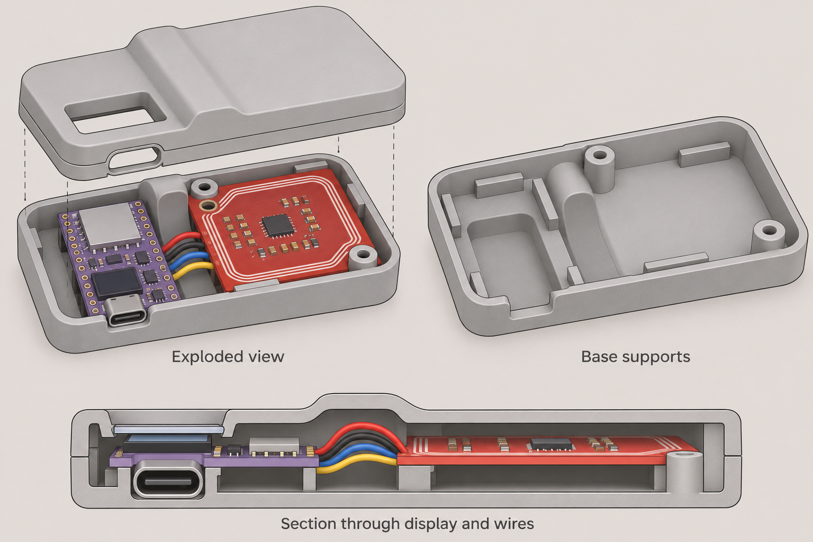

### USB-C, OLED, and mounting details

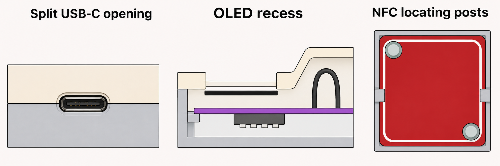

Use the exploded render for the enclosure layout and the detail render for the USB seam and NFC post alignment. The exploded render places part of the USB opening in a closed loop and misaligns an NFC post. Both renders are concept previews with approximate hardware shapes.

**Accepted USB-C detail.** The wall opening is made from two open-ended notches, one in the lid and one in the base. Each notch opens onto its part's mating edge. The closed enclosure surrounds the receptacle and leaves room for the plug overmold. The lid fastening and exact notch profile are open CAD decisions.

### Handheld toy shapes

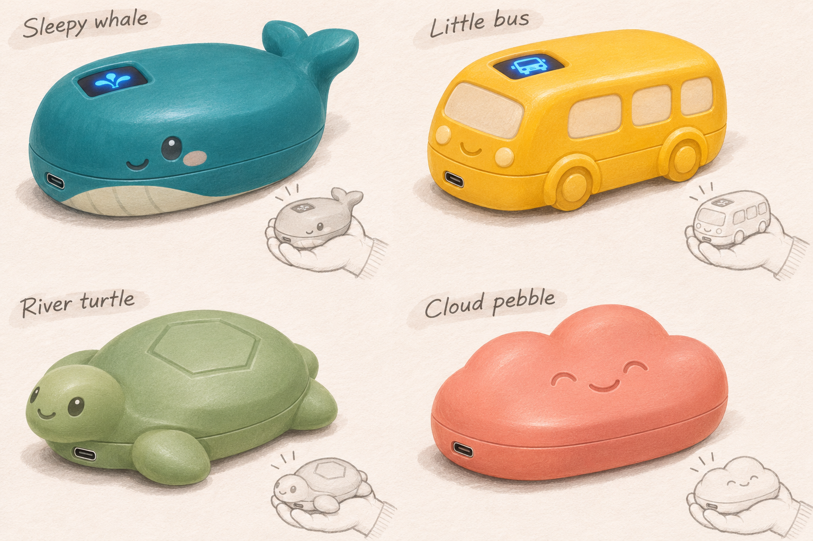

The whale uses the display as a blowhole, and the bus uses it as a destination sign. The turtle's shell marking gives the child a place to tap a tag. The cloud's shallow lobes give fingers a resting place around the body. These are shape studies. Grip, electronics fit, and suitability for a two-year-old still need evaluation.

### Centered front USB-C and flat tag surface

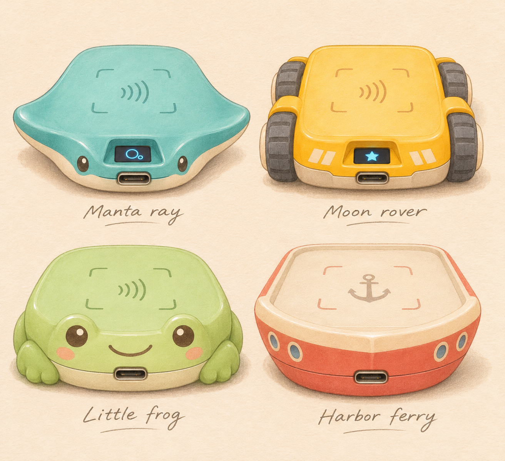

The owner chose the USB-C mouth as the center of the front silhouette. The shell can extend on both sides to achieve this. The new placement photo shows the PN532 behind the ESP32, with the OLED fixed to the ESP32 just behind the connector. The manta ray and moon rover bring a recessed bezel down to that horizontal display. The frog and ferry leave the display covered. All four reserve a clear area over the reader for a tag object. In a ferry version, keep the illustrated deck rim flush so a wider tag object can rest flat.

These concepts explore a front-to-back layout. The measurements and first base render below document the earlier side-by-side fit.

### Selected shape · Manta ray

The manta has two printed parts, a blue upper shell and a white belly. The seam passes through the centered front USB-C opening. A low window follows the board-mounted OLED. Shallow oval eye recesses in the blue print guide the paint.

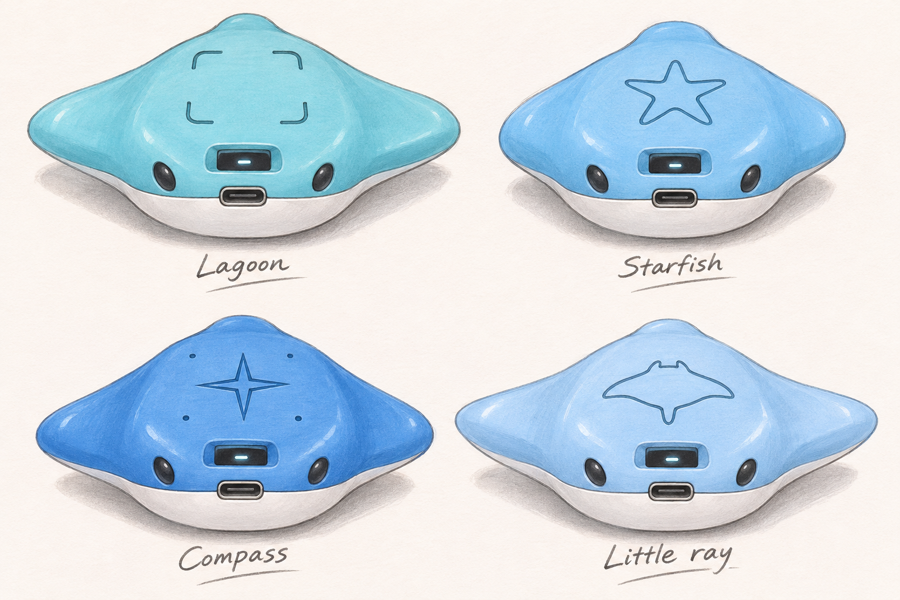

The tap surface stays flat over the PN532. Lagoon frames the area with four engraved corners. Starfish marks the center with a five-armed star. Compass combines a central rose with four corner dots. Little Ray marks the spot with a small manta silhouette.

**Selected design.** Use Lagoon’s broad wing proportions and a single engraved Little Ray silhouette centered on the outer manta and contained within the PN532 footprint. The sketch establishes proportions. Overall span and body depth will follow from the board layout and a hand-size review.

## Measurements for the first CAD fit

The table records the owner's readings in **millimetres**. Entries marked derived, optional, or pending are identified in the last column. Use the sketches to identify endpoints. Their proportions are schematic.

With both boards component-side up and the USB-C receptacle nearest you, **front** is the near edge, **left** is your left, and each board has its own front-left PCB datum. Measure from the straight edges, extended through any rounded or clipped corner. Positive x runs right and positive y runs away from you in the component-side views. Height references are shown separately.

### A · ESP32 board and OLED

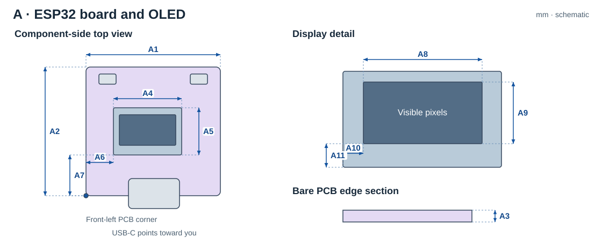

| ID | Measure | Measured (mm) |
| --- | --- | --- |
| A1 | Bare PCB width, straight left edge to straight right edge | 20.6 |
| A2 | Bare PCB depth, front edge to rear edge | 25 |
| A3 | Bare PCB thickness at a clear edge | 1.2 |
| A4 | OLED glass width, left to right | 12 |
| A5 | OLED glass depth, front to rear | 11 |
| A6 | PCB left edge to glass left edge | 3.8 |
| A7 | PCB front edge to glass front edge | 8.6 |
| A8 | Visible pixel area width, left to right | 10.5 |
| A9 | Visible pixel area depth, front to rear | 6.5 |
| A10 | Glass left edge to visible pixel area's left edge | 0.75, derived as (12 − 10.5) / 2. The owner estimated about 1 and chose a symmetric left and right margin for CAD. |
| A11 | Glass front edge to visible pixel area's front edge | 4.2 |

### B · USB-C receptacle and cable

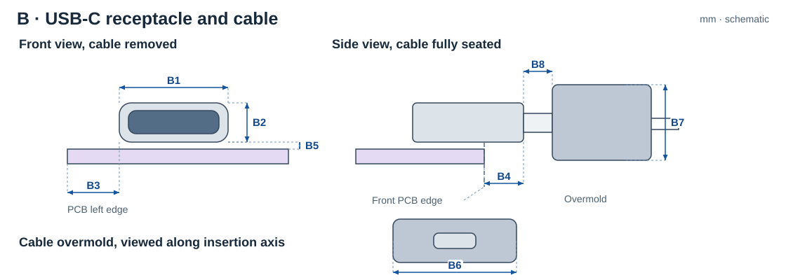

| ID | Measure | Measured (mm) |
| --- | --- | --- |
| B1 | Receptacle metal shell outer width at the mouth | 8.85 |
| B2 | Receptacle metal shell outer height at the mouth | 3 |
| B3 | ESP32 PCB left edge to left edge of the receptacle shell, viewed from the front | 5.6 |
| B4 | ESP32 PCB front edge to receptacle mouth plane. Positive if the mouth projects past the PCB. | 2 |
| B5 | Receptacle shell bottom height relative to the ESP32 PCB top. Positive above the PCB top, negative below it. | 0 |
| B6 | Width of the plastic grip on the cable plug, viewed from the tip end | Optional if the grip stays outside the case |
| B7 | Height of the same plastic grip, viewed from the tip end | Optional if the grip stays outside the case |
| B8 | With the plug fully seated, distance along the insertion axis from the receptacle mouth to the closest plastic shoulder. Record 0 if they touch. | Optional with the receptacle mouth flush or proud of the case face |

For the first fit, place the outer wall at or slightly behind the receptacle mouth and keep the approach clear. B1–B5 locate and size the receptacle for the two notches. If the design recesses the port, B8 gives the available depth before the plug shoulder hits the wall. B6 and B7 size a larger relief if that shoulder needs to enter the case. Check full seating with the intended cable on the first print.

### C · PN532 board and mounting holes

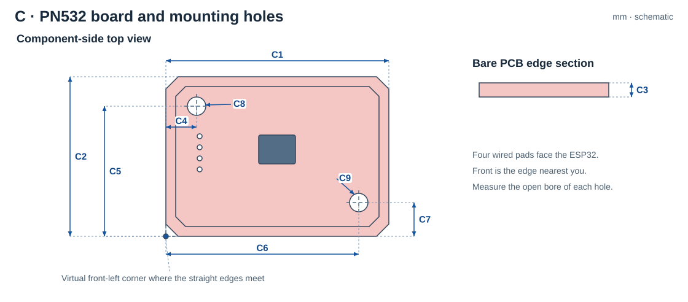

| ID | Measure | Measured (mm) |
| --- | --- | --- |
| C1 | Bare PCB width, straight left edge to straight right edge | 42.8 |
| C2 | Bare PCB depth, front edge to rear edge | 40.6 |
| C3 | Bare PCB thickness at a clear edge | 1.5 |
| C4 | Left edge to rear-left hole center | 7.3 |
| C5 | Front edge to rear-left hole center | 32.8 |
| C6 | Left edge to front-right hole center | 35.3 |
| C7 | Front edge to front-right hole center | 7.3 |
| C8 | Rear-left hole inside diameter | 3.1 |
| C9 | Front-right hole inside diameter | 3.1 |

To get a hole center from an edge, measure to the nearest inside edge of the hole and add half its diameter. If a board corner is clipped or rounded enough to affect a support, note the corner and the clipped length along each edge or the approximate radius.

### D · Installed heights and harness envelope

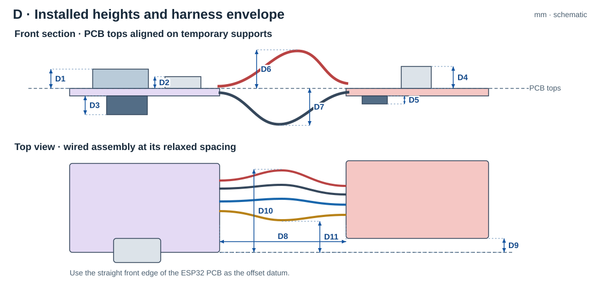

Rest the wired boards on temporary supports at clear edges and align the **top faces of the bare PCBs** to a shared level. Use a straightedge and leave room below for the underside components and wires. Adjust the gap to a natural position where the leads relax and neither board is pulled or twisted. Record the harness heights and top-view positions in that same setup.

| ID | Measure | Measured (mm) |
| --- | --- | --- |
| D1 | ESP32 PCB top to top of OLED glass | 3.8 |
| D2 | ESP32 PCB top to highest other top-side feature under the lid, excluding the OLED and USB-C shell | 3.3, set by the buttons |
| D3 | ESP32 PCB underside to lowest rigid underside feature, including components and solder joints | 2.4 near the center. Edge pin-hole undersides are reported approximately flush or can be cleaned. |
| D4 | PN532 PCB top to highest top-side feature, including the mode switch and any rigid solder | 4.15 |
| D5 | PN532 PCB underside to lowest rigid underside feature, including solder tails | 3.5 at the solder points |
| D6 | Shared PCB top plane to highest point of the four-wire harness above it | 4.4, reported at the 12 mm trial gap without an increase in height |
| D7 | Shared PCB top plane to lowest point of the four-wire harness below it, including any routing beneath the boards | 0, all four wires route above the boards on this assembly |
| D8 | Horizontal gap between the two facing PCB edges | 24 at the initial spacing, 12 with the leads pushed closer. Use 12 for the first fit. |
| D9 | PN532 front edge setback from the ESP32 PCB front edge. Positive if the PN532 edge is farther away from you. | 0. The owner confirmed the harness allows both front edges to align at the 12 mm gap. |
| D10 | ESP32 PCB front edge to rearmost wire surface in the gap, as seen from above | 24.8 reported. Reserve the full 25 mm PCB depth in CAD. |
| D11 | ESP32 PCB front edge to frontmost wire surface in the gap, as seen from above | 0 |

For D6 and D7 use the outside of the insulation. If the boards cannot rest with their tops level without stressing the wires, record the PN532 top height relative to the ESP32 top and use the **ESP32 top** as the reference for D6 and D7. The first fit must leave the solder joints unloaded and preserve the wire clearance with the lid closed.

### E · ESP32 support contact

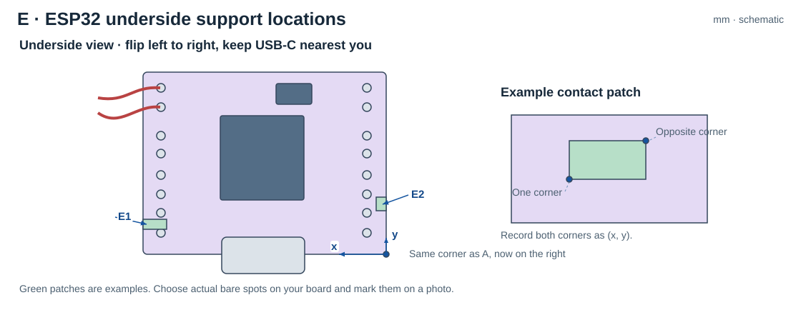

The underside drawing shows the original two-patch concept. Flip the ESP32 left to right with USB-C still nearest you to compare it with the actual board. The owner chose two **3 mm-wide underside ledges**, one along each side. The ledges may extend under the pin-hole rows where the underside is flush. Keep the top side around both rows clear of lid features. Provide a central pocket for the 2.4 mm projection and relieve any solder that still protrudes into a ledge. Confirm that the PCB seats without rocking on the first fit print.

| ID | Observation | Reported (mm) |
| --- | --- | --- |
| E1 | Approximate isolated bare patch width on one edge | 1, uncertain |
| E2 | Approximate isolated bare patch width on the other edge | 1 |

### Measurement record

| Item | Record |
| --- | --- |
| Readings reported | 2026-11-28, owner measurements in the enclosure discussion |
| ESP32 PCB markings | |
| PN532 PCB markings | |
| USB cable used | |
| Supporting photos or notes | |

Keep any original measurement photos in the NFC reader Drive folder and record their paths relative to that folder here. CAD can use the filled table to set the first fit geometry. Shell clearances, fastening, and the NFC tap-face thickness will be checked with the fit print and a Topaz tag.

## CAD iterations

### Fastening options · Design discussion

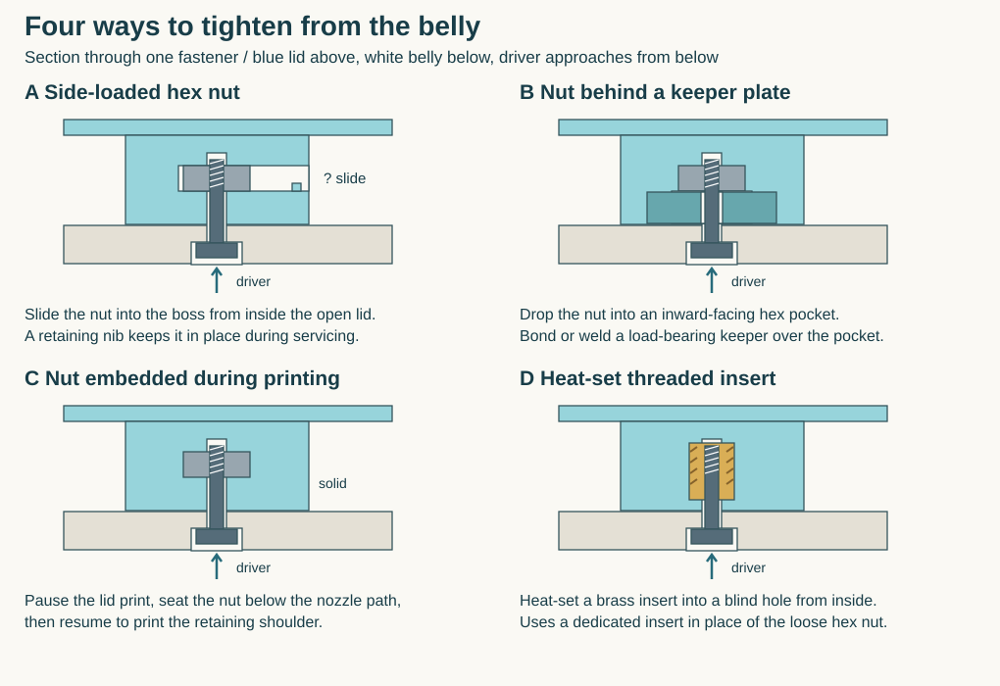

The owner's screw measures 2.92 mm across the threads, with a 5.1 mm head, approximately 1.47 mm head height, and 7.4 mm overall length. The hex nut measures 5.3 mm across flats, 2.45 mm thick and roughly 2.55 mm at the bore. Likely M3 × 0.5, with about 6 mm under the head if it has a flat bearing face. Confirm the pitch and head profile before sizing the joint. With this short screw, full engagement through the measured nut leaves about 3.5 mm from the underside of the head to the near face of the nut.

Option A uses the supplied nut and allows replacement from inside. The screw draws the nut onto a printed shoulder. The retaining nib only keeps it from sliding out when the lid is removed. The four options are proposals for a later revision.

Each iteration records its renders, design changes, and fit checks here.

### CAD iteration 1 · Base

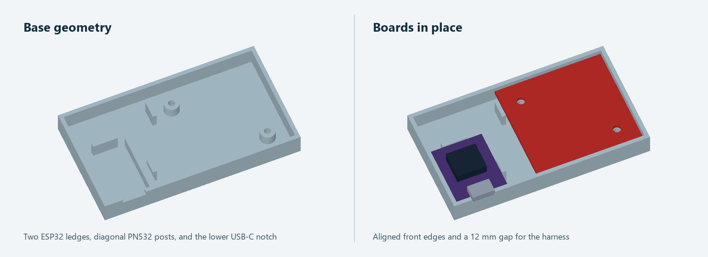

The first model places the aligned PCBs 12 mm apart. It shows the two 3 mm ESP32 ledges, diagonal PN532 posts, and the open lower USB-C notch. The colored boards, OLED, and connector are simplified fit envelopes. The tray is 79.30 × 44.45 × 9.30 mm at the default 0.35 mm PCB side clearance.

The [CAD project](../../../model-projects/nfc-reader/README.md) has verified viewer entries for the bare base and the base with board envelopes. The base exports passed STEP and mesh verification. The lid and case fastening are the next iteration. Ledge contact, pilot sizing, and cable seating still need a physical fit check.

### Manta iteration 1 · Board placement

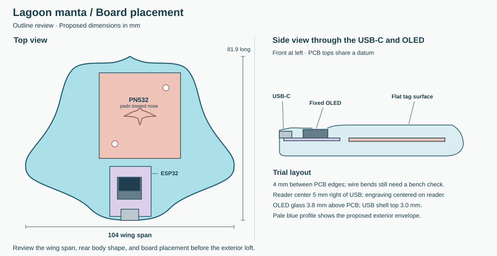

The trial silhouette spans 104 mm and measures 81.9 mm from nose to tail. The PN532 sits behind the ESP32 with its wired pads facing forward. A proposed 4 mm gap and 5 mm rightward reader offset keep the tag face over the coil and leave the front connector centered. The actual harness still needs checking in this placement. The boards, OLED and USB mouth use the bench dimensions. The shell profile is provisional.

**Review checkpoint.** Confirm the wing breadth, rear silhouette and board placement before shaping the exterior in 3D.

### Manta iteration 1b ? Aligned left edges

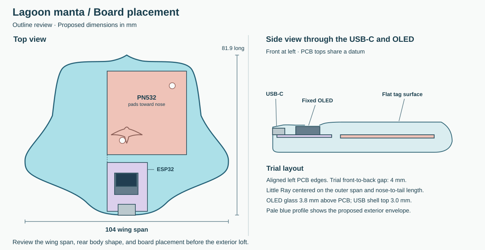

With USB-C toward the nose, the PN532 sits behind the ESP32 and their left PCB edges line up for the existing harness. The trial outline keeps the 104 mm span and 81.9 mm length. Both rear shoulders widen slightly to clear the shifted reader. The 16 mm-wide emblem sits halfway across the wings and halfway from nose to tail, fully within the reader footprint with about 1.8 mm to spare at its closest edge including the drawn stroke. The 4 mm board gap is provisional pending a wire fit check.

### Manta iteration 2 · Exterior

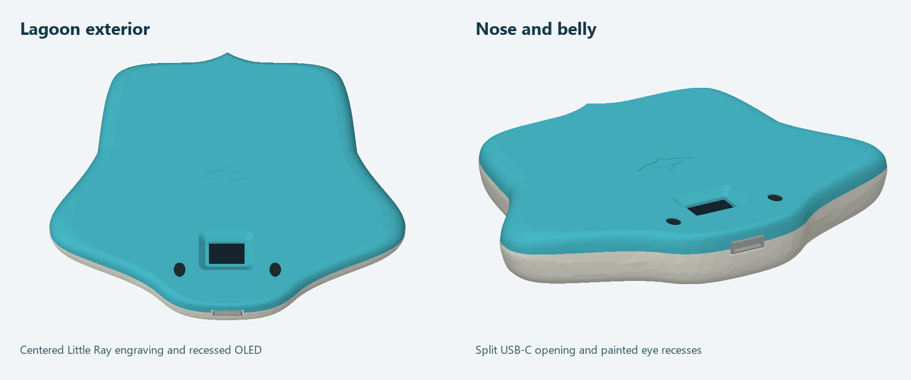

The smooth exterior follows the approved aligned-board layout. The exported assembly measures 104.23 × 82.00 × 14.20 mm including the USB reference. The seam crosses the middle of the port. The bezel descends to the fixed OLED glass at 3.8 mm above the PCB. The centered Little Ray engraving is 0.24 mm deep in the flat blue tap surface.

The CAD viewer entry is **Lagoon manta exterior**. The STEP round-trip volume matches the native assembly and the GLB mesh is watertight. This stage is a solid exterior study. Hollowing, board retention, cable clearance and fasteners belong to the fit iteration after exterior review.

### Manta iteration 3 · Internal fit

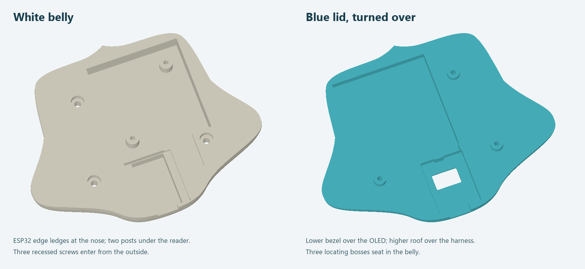

The belly supports the ESP32 on two 3 mm ledges and the PN532 on two posts. The center pocket leaves 1.8 mm below the lowest measured ESP32 component, and the reader pocket leaves 1 mm below its solder tails. The upper wire corridor leaves 0.65 mm above the reported wire height. The bezel leaves 0.3 mm above the OLED glass. Both eye recesses are features of the single blue lid.

Three stepped screw locations register the halves outside the reader footprint. The trial closure assumes M2.5 × 10 mm low-profile screws, head diameter up to 5 mm and head height up to 2 mm, entering from the belly. The two PN532 posts have 2.06 mm pilots for trial M2.5 nylon screws. Physical checks include screw engagement, the small lid stop over the rear middle ESP32 edge, wall thickness at the front PCB corners and the reader’s rear-right corner, actual harness routing across the 4 mm gap, USB seating, and tag reads through the lid.

| First-fit part | CAD solid | Print mesh |
| --- | --- | --- |
| White belly | [STEP](.cache/cad-context/projects/nfc-reader/cad/lagoon-fit-belly/lagoon-fit-belly.step) | [STL](.cache/cad-context/projects/nfc-reader/cad/lagoon-fit-belly/lagoon-fit-belly.stl) |
| Blue lid | [STEP](.cache/cad-context/projects/nfc-reader/cad/lagoon-fit-lid/lagoon-fit-lid.step) | [STL](.cache/cad-context/projects/nfc-reader/cad/lagoon-fit-lid/lagoon-fit-lid.stl) |

Both parts passed all eight CAD export checks. Intersections of the two closed shells and of each shell with the modeled boards, glass, connector and sampled wire corridor had zero volume. Both generators are registered in the NFC reader model project as `lagoon-fit-belly` and `lagoon-fit-lid`. These local files support a bench fit print. Physical assembly and suitability for toddler use remain unverified.

### Manta iteration 4 ? Seam-down shells and captive nuts

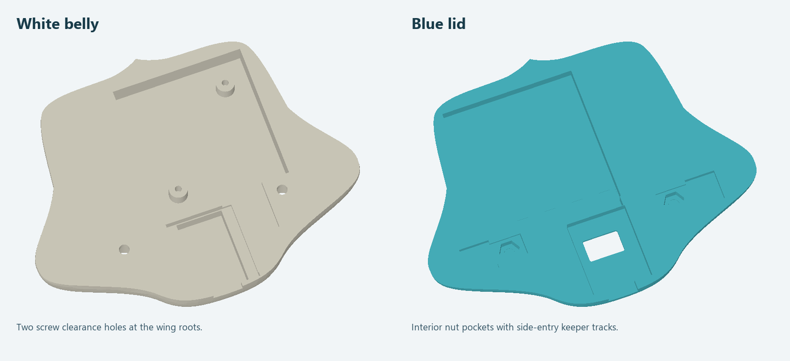

Both shell meshes are exported with the mating plane at Z = 0. The closure uses two underside screws at the wing roots. The screw head pockets are 5.7 mm across and the shank holes are 3.3 mm. The design assumes a flat bearing face on the reported 5.1 mm head and 5.93 mm of usable screw length. The two internal reader posts still take the earlier M2.5 nylon fasteners.

At either closure screw, the nominal depth from the head seat to the blind end is 6.12 mm. The measured 5.93 mm under-head length leaves 0.19 mm tip clearance. With the keeper against its shoulders, the far face of the 2.45 mm nut is 5.75 mm from the head seat, so the tip projects 0.18 mm past the nut. This margin needs checking on the physical print.

With the lid open, place a hex nut in each blind 5.65 mm across-flats pocket. Lower a keeper into the adjacent loading bay, slide it under the retaining shoulders until its hole lines up with the nut, and secure it against sliding out. The shoulders carry the screw load. Verify nut retention with the case open and both screws removed. The 0.8 mm keeper, thread engagement, front USB alignment, nose and tail seating, and physical retention require a bench trial.

| Part | CAD solid | Seam-down print mesh |
| --- | --- | --- |
| White belly | [STEP](.cache/cad-context/projects/nfc-reader/cad/lagoon-seam-belly/lagoon-seam-belly.step) | [STL](.cache/cad-context/projects/nfc-reader/cad/lagoon-seam-belly/lagoon-seam-belly.stl) |
| Blue lid | [STEP](.cache/cad-context/projects/nfc-reader/cad/lagoon-seam-lid/lagoon-seam-lid.step) | [STL](.cache/cad-context/projects/nfc-reader/cad/lagoon-seam-lid/lagoon-seam-lid.stl) |
| Nut keeper, print two | [STEP](.cache/cad-context/projects/nfc-reader/cad/lagoon-seam-keeper/lagoon-seam-keeper.step) | [STL](.cache/cad-context/projects/nfc-reader/cad/lagoon-seam-keeper/lagoon-seam-keeper.stl) |

All three generators passed eight CAD checks each. The reported screw and nut envelopes fit, and the keeper clears the track at five positions. A PrusaSlicer 2.9.7 trial using a 0.4 mm nozzle, 0.2 mm layers and supports disabled flagged long bridges in both halves, floating features in the belly, and loose extrusions in the lid. Inspect internal supports for the reader posts and cavity roofs before printing. The rims themselves sit directly on the bed.
